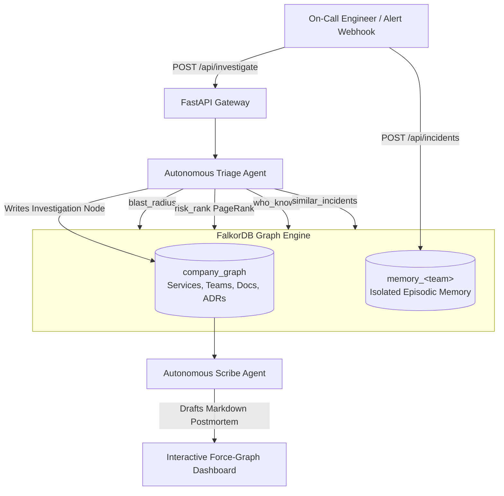
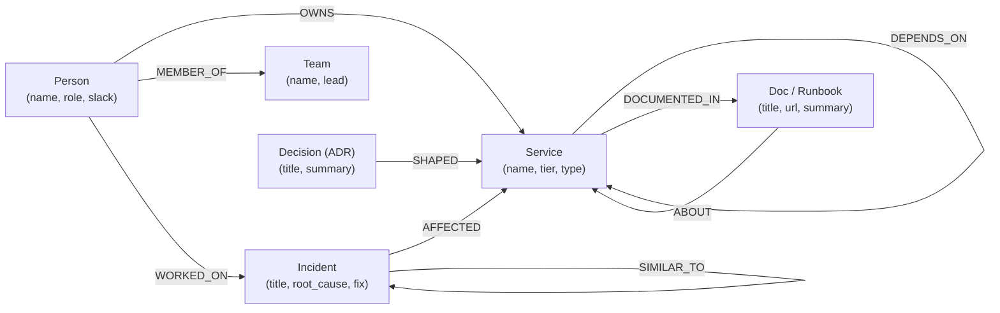
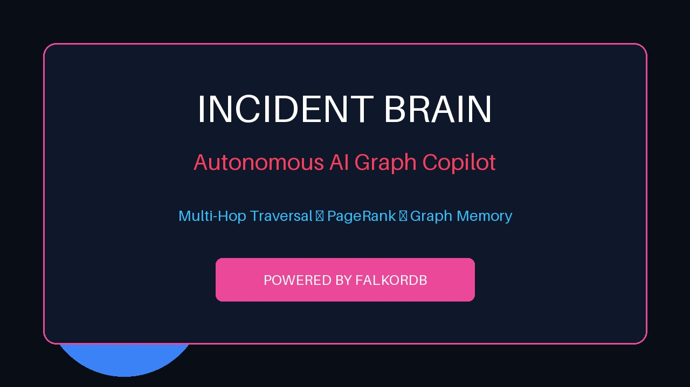

# 🧠 Incident Brain
> **Autonomous Incident Copilot Powered by FalkorDB Graph Topology, Matrix PageRank, and Persistent Team Memory**  
> *Built for Graph Hacks 2026 (WeMakeDevs x FalkorDB)*  
> **Author**: Vidisha Gupta (Solo) | **License**: MIT

[](https://falkordb.com)
[](https://fastapi.tiangolo.com)
[](https://python.org)
[](/tests)
[](LICENSE)

---

## 📌 The Problem
When a critical microservice degrades in production:
1. **The Blast Radius is Unknown**: Engineers frantically guess which downstream customer-facing APIs are degrading across multi-tier dependencies.
2. **Tribal Knowledge is Lost**: "Who owns this service?" "Who resolved the last connection pool leak?" Questions languish in Slack channels while MTTR climbs.
3. **Repeated Outages**: Teams fix the same failure modes again and again without a persistent, searchable system memory across sessions.
4. **LLM Hallucinations**: Generic AI chatbots propose speculative fixes because they lack grounding in the company's real dependency and incident topology.

---

## 💡 The Solution: Incident Brain
**Incident Brain** is an autonomous incident response agent built on **FalkorDB**. When an outage alert fires or an engineer selects a failing service:
1. **Multi-Hop Traversal**: Discovers the true downstream blast radius up to 4 hops away using parameterized Cypher.
2. **PageRank Risk Scoring**: Employs FalkorDB’s GraphBLAS matrix algorithm (`CALL algo.PageRank`) to score and rank downstream service criticality.
3. **Expert Identification**: Traverses `(:Person)-[:OWNS]->(:Service)` and `(:Person)-[:WORKED_ON]->(:Incident)` to rank the right responders with direct Slack links.
4. **Historical Incident Memory**: Matches similar past outages via `:SIMILAR_TO` edges to surface verified root causes and battle-tested fixes.
5. **Multi-Agent Handoff**: A **Triage Agent** investigates the graph and logs an `Investigation` node; a **Scribe Agent** reads the graph and synthesizes an automated incident postmortem.
6. **Persistent Memory Across Sessions (Track 2)**: Written remediations are saved to isolated FalkorDB memory graphs (`memory_<team>`), instantly teaching the agent how to solve future outages.

---

## 🏆 Hackathon Track Mapping (Enters All 3 Tracks)

| Track | How Incident Brain Solves It |
|---|---|
| **Track 1: Agents Acting on Connected Data** | Autonomous Triage Agent traverses multi-hop dependency chains (`DEPENDS_ON*1..4`), runs FalkorDB GraphBLAS PageRank (`CALL algo.PageRank`), and pinpoints causal paths via `shortestPath`. 100% grounded in FalkorDB facts. |
| **Track 2: Agent Memory Across Sessions** | Multi-graph isolation: each squad gets a dedicated episodic memory graph (`memory_core_platform`, `memory_payments_squad`, `memory_reliability_ops`). Logged fixes persist across sessions and immediately ground subsequent investigations. |
| **Track 3: Company Brain** | Unifies enterprise technical knowledge in `company_graph`: microservices, tiering, ownership hierarchies (`OWNS`), team memberships (`MEMBER_OF`), runbooks (`DOCUMENTED_IN`), and Architectural Decision Records (`SHAPED`). |

---

## 🏗️ Architecture & Flow



---

## 🧬 Graph Data Model & Schema



---

## ⚡ Quickstart: One-Command Setup

### Option 1: Docker Compose (Recommended)
Clones and launches FalkorDB and the FastAPI backend together:
```bash
git clone https://github.com/vidishagupta/incident-brain.git
cd incident-brain
docker compose up --build
```
Open your browser at **`http://localhost:8000`**.

---

### Option 2: Local Python Virtual Environment

1. **Clone & Setup Environment**:
   ```bash
   git clone https://github.com/vidishagupta/incident-brain.git
   cd incident-brain
   python -m venv .venv
   source .venv/bin/activate  # On Windows: .venv\Scripts\activate
   pip install -r requirements.txt
   ```

2. **Run FalkorDB (via Docker or FalkorDB Cloud)**:
   ```bash
   docker run -p 6379:6379 -it --rm falkordb/falkordb:latest
   ```
   *(Note: Incident Brain includes a built-in Cypher GraphBLAS simulator fallback so the entire application, API, and tests run out of the box even without Docker).*

3. **Start the Application**:
   ```bash
   uvicorn app.main:app --host 0.0.0.0 --port 8000 --reload
   ```
   Open **`http://localhost:8000`** in your browser.

---

## 🧪 Running Tests
Incident Brain has a comprehensive test suite covering all agent tools, 3 sample incidents end to end, API endpoints, and team memory isolation:
```bash
pytest -v
```
**Results**: 21/21 passing tests (100% pass rate).

---

## ⚙️ Environment Configuration

Copy `.env.example` to `.env`:
```bash
cp .env.example .env
```

| Variable | Default | Description |
|---|---|---|
| `FALKORDB_URL` | `redis://localhost:6379` | Connection string for FalkorDB standalone or FalkorDB Cloud |
| `LLM_PROVIDER` | `deterministic` | Mode: `deterministic` (free, zero keys) or `groq`, `openai`, `gemini` |
| `LLM_API_KEY` | *(empty)* | Optional API key if using an external LLM |
| `COMPANY_GRAPH` | `company_graph` | Name of the primary company knowledge graph |
| `PORT` | `8000` | Application server port |
| `HOST` | `0.0.0.0` | Application bind address |

---

## 🎬 Demo Video & Media
- **Demo Video Script**: [`docs/demo-script.md`](docs/demo-script.md)
- **Technical Blog Post**: [`docs/blog-post.md`](docs/blog-post.md)
- **Official Submission Text**: [`docs/submission.md`](docs/submission.md)
- **Video Generator**: `python video/build_video.py` generates the 1920x1080 MP4 demo with AI voiceover and burned-in subtitles.



---

## 📄 License
MIT License — Copyright (c) 2026 Vidisha Gupta.
